# HW Design-Space Agent

**An agent optimised for hardware development: trade-off exploration.**

The showcase site for [HW_Design_Space_Agent](https://github.com/BrendanJamesLynskey/HW_Design_Space_Agent), a
LangGraph agent that explores hardware trade-offs from one spec. Every page is built around an animation, and every
number on it comes from the agent's recorded runs (vendored at a pinned commit, with hashes) or from TypeScript ports
of its tested models, which reproduce the Python reference exactly.

**Live:** https://hw-design-space-agent.vercel.app

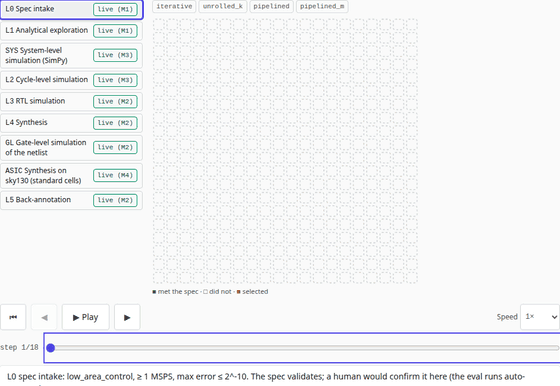

> _An AI agent is the perfect environment for trade-off exploration._ · _Avoid premature optimisation._

## Pages

| Page            | The animation                                                                                                                                                                                                                                                                                                                                                                                                                                                                                                                                                                                                                                                                                                                                                                                                                                                                                                                                                                                                                                                                                                                                                                                                                                                                                                                                                                                                                                                                                                                                          | Driven by                                                                                                                                                                                         |
| --------------- | ------------------------------------------------------------------------------------------------------------------------------------------------------------------------------------------------------------------------------------------------------------------------------------------------------------------------------------------------------------------------------------------------------------------------------------------------------------------------------------------------------------------------------------------------------------------------------------------------------------------------------------------------------------------------------------------------------------------------------------------------------------------------------------------------------------------------------------------------------------------------------------------------------------------------------------------------------------------------------------------------------------------------------------------------------------------------------------------------------------------------------------------------------------------------------------------------------------------------------------------------------------------------------------------------------------------------------------------------------------------------------------------------------------------------------------------------------------------------------------------------------------------------------------------------------ | ------------------------------------------------------------------------------------------------------------------------------------------------------------------------------------------------- |
| `/` Home        | **One spec, every level**: a spec card enters the fidelity ladder; at L1 the 400 evaluations of a real recorded M2 run fill in round by round, the LLM's decisions and token/$ counters tick from its trace, the chosen design (the true optimum) is marked, then goes down the live levels: RTL in two simulators, synthesis, the gate-level netlist and the run's own back-annotation. The system and cycle levels (live since M3) and the ASIC target (live since M4) are marked as not used: the spec has no system scenario and targets the FPGA                                                                                                                                                                                                                                                                                                                                                                                                                                                                                                                                                                                                                                                                                                                                                                                                                                                                                                                                                                                                  | the recorded run (Sonnet 5.5, `low_area_control`, M2 seed 2) and the repo's worked example of the design it selected                                                                              |
| `/why`          | **Micro-optimise the default, or explore first**: a hill-climb from the reference iterative CORDIC against the iterative family's ceiling and the true Pareto front, on the real grid. With the Knuth quote, verified against the paper                                                                                                                                                                                                                                                                                                                                                                                                                                                                                                                                                                                                                                                                                                                                                                                                                                                                                                                                                                                                                                                                                                                                                                                                                                                                                                                | `hw_dse.evaluate` on all 39,690 iterative designs; the exhaustive ground truth                                                                                                                    |
| `/case-study`   | **high_precision: m=6 or m=8?** now in seven views (three models, incl. the rejected class-factor candidate; Vivado at 10 ns and at the spec's own 20 ns clock); **CORDIC micro-rotations, bit for bit** (sliders for W, N and the angle; exact error over all 2^W angles in a Web Worker); **the families as datapaths** (angles flowing cycle by cycle, with throughput, latency, LUTs, FFs and Fmax); **the true Pareto front** with a readout; **measured against estimated** (every synthesised design, tool by tool, then the refit); **high_precision: m=6 or m=8?** (the winner against its neighbour, from the M1 estimate to Vivado's routed timing)                                                                                                                                                                                                                                                                                                                                                                                                                                                                                                                                                                                                                                                                                                                                                                                                                                                                                         | TS ports of the bit-exact golden model and the Artix-7 cost model; the L4/Vivado tables and the L5 refit report                                                                                   |
| `/how-it-works` | **The graph, replayed from a recorded trace**: the LangGraph nodes light up in the order a real run went through them (M2's `back_annotate` included), the LLM's structured decisions quoted as returned, code's front-mapping rounds and hard rules shown, token and $ counters ticking; any of the 108 runs (M1 and M2). **multiaxis_control: why m=4** (M3): one control tick's 32 requests drained by the three designs the three views of the spec pick, against the 0.44 µs deadline, then all 400 ticks with the L1 bound and the simulated p99. **The cycle model against the RTL** (M3): the interface edge by edge on the RTL check's stimulus, and the 48 recorded comparisons. **One design down the ladder**: L1 estimate, generated RTL, two simulators, formal, synthesis, gate level, measured against estimated, the refit. **FPGA or ASIC** (M4): the same three specs on sky130 and on their FPGA twins, the family ranking then every pipelining depth m on both targets. **The held-out check** (M4): the 9 sky130 designs the model never saw, estimate against measurement. **The deadline miss** (M4): the `asic_multiaxis_control` winner in the control loop at its estimated and its measured clock (M3's replay, reused). **The fleet** (M4): one real fleet run's members, Store, lessons, phase-2 split and warm start, then the paired A/B pair by pair. Also the ladder with badges, verification per family, the ASIC calibration, L2 → L1 feedback, the experimental campaign agent and the measured fleet timelines | the run's `llm_trace.jsonl`, `report.md` and `evaluations.csv`, checked against each other and its summary; the repo's worked example and L3 tables                                               |
| `/results`      | **The local Vivado runs after M4, then Milestone 4, losses first**: m=8 measured at its own 20 ns clock, the class path factor rejected by its pre-set rule, the refit counted once, routed against synthesised Fmax per family, and the first measured FPGA power against the power index (charts and tables); then M4: the fleet's hypervolume loss (paired sign and t tests, before and after the fix), the measured deadline miss, the optimistic Fmax; then the fleet A/B (Sonnet on one spec by the owner's choice), Qwen's regret gain with its timing caveat, throughput with labelled projections, the ASIC eval, the ASIC ground truth on both targets, L2 → L1 feedback and the M4 spend. Then **Milestone 3**: the A/B of the structured graph against the campaign agent (HV, regret, cost, tokens, wall-clock, failures per model; Sonnet on one spec by the owner's choice), memory on/off, the system specs in four views (simulated, L1 bound, average-rate and peak-rate floors), the structured graph on them, the offline `map_front` fix and the M3 spend. Then **M1 → M2 against NSGA-II** (hypervolume and regret, spec by spec); where it got worse, first; **Pareto replay** of any recorded run; **the hypervolume race** (M2 or M1); per-spec tables (mean ± std over 5 seeds) with the selected designs, tokens, $ per run and $ per evaluated design; the spend three ways; a **cost and labour calculator** whose people-side figures the reader enters; M1's results kept                                               | the M3 summaries, ledger, key usage and traces; the runs' evaluations; the baselines re-run with the repo's own code (each reproduces `baselines.json` / `baselines_m2.json` exactly); results.md |
| `/writeup`      | the repository's final write-up (`docs/WRITEUP.md` at the vendored commit), rendered unedited as plain Markdown (dollar amounts intact), its ladder flowchart drawn, each section's named facts listed with their values                                                                                                                                                                                                                                                                                                                                                                                                                                                                                                                                                                                                                                                                                                                                                                                                                                                                                                                                                                                                                                                                                                                                                                                                                                                                                                                               | `docs/WRITEUP.md` and `docs/writeup_facts.json`                                                                                                                                                   |
| `/adoption`     | **For a hardware team**: where the agent would help a company that builds its own hardware and where it would not (each claim linked to its evidence at the vendored commit), a comparison with a general-purpose agent by capability, a proposed deployment next to an EDA farm drawn as **one request through the system** (what exists today vs what is proposed, step by step), and an improvement roadmap (done after M4, the repository's own next steps read from the write-up, a team's additions marked as proposals)                                                                                                                                                                                                                                                                                                                                                                                                                                                                                                                                                                                                                                                                                                                                                                                                                                                                                                                                                                                                                         | `src/data/*.json`, `docs/WRITEUP.md` and `docs/writeup_facts.json`                                                                                                                                |
| `/roadmap`      | M1–M4 (all done) with status from the README roadmap (with its follow-up rows), what each adds to the ladder, the PRs (incl. #7, the local Vivado runs); "Done after M4" with its outcome; then the after-M4 plan from the record, with no results                                                                                                                                                                                                                                                                                                                                                                                                                                                                                                                                                                                                                                                                                                                                                                                                                                                                                                                                                                                                                                                                                                                                                                                                                                                                                                     | the vendored README                                                                                                                                                                               |
| `/record`       | **Project record: how it was built and why**: summary, principles, the planner/executor process and its verification gates, the decision log as a timeline, results, what review found, limitations, what's next                                                                                                                                                                                                                                                                                                                                                                                                                                                                                                                                                                                                                                                                                                                                                                                                                                                                                                                                                                                                                                                                                                                                                                                                                                                                                                                                       | `content/record/project_record.md` (the planner's record, checked number by number against the vendored data in `tests/unit/record.test.ts`)                                                      |
| `/about`        | software and hardware, two columns, each line linked to the owner's personal projects on GitHub                                                                                                                                                                                                                                                                                                                                                                                                                                                                                                                                                                                                                                                                                                                                                                                                                                                                                                                                                                                                                                                                                                                                                                                                                                                                                                                                                                                                                                                        | —                                                                                                                                                                                                 |

### The animations

Recorded frame by frame from the model states (`pnpm animations`, against a local build; reduced motion, every frame
set by the scrub bar), so each GIF is reproducible.

|                                                                                      |                                                                                        |
| ------------------------------------------------------------------------------------ | -------------------------------------------------------------------------------------- |
| 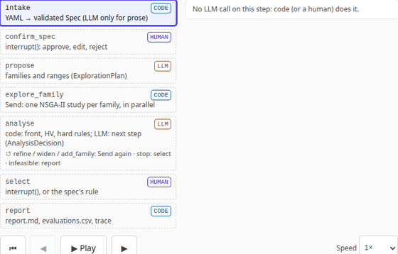             | 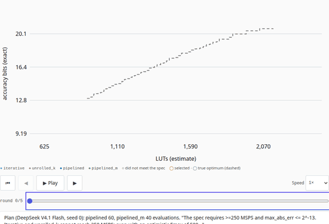                       |
| 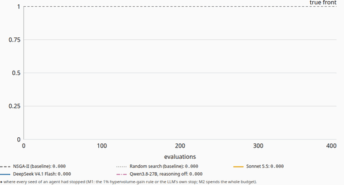                                      | 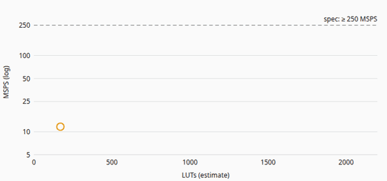 |
| 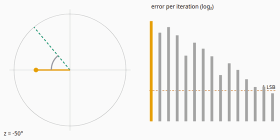            | 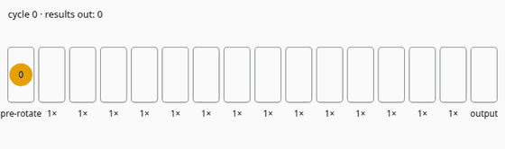                         |
| 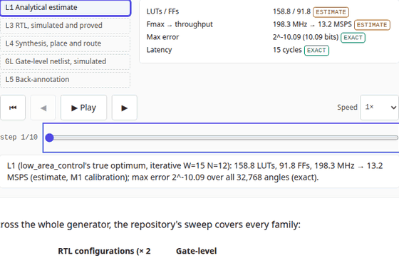                 | 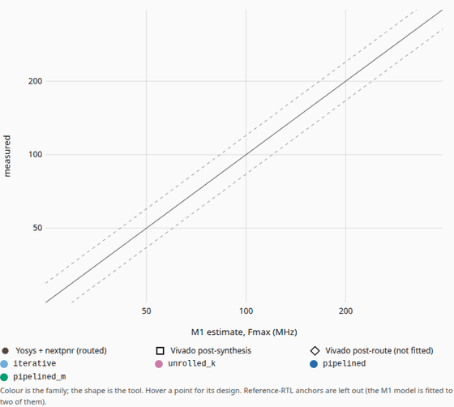                     |
| 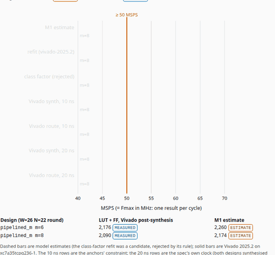                        | 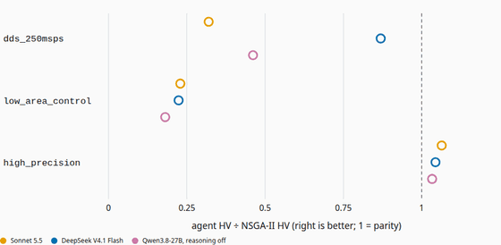                                   |
| 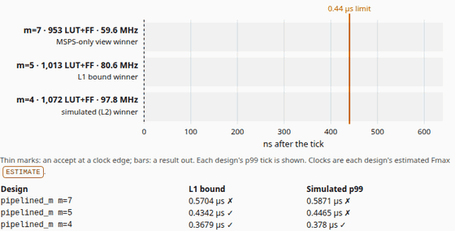        | 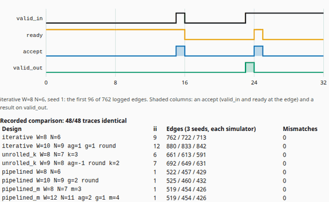                        |
| 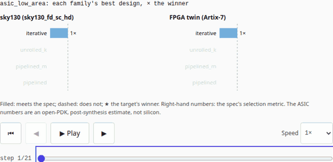             | 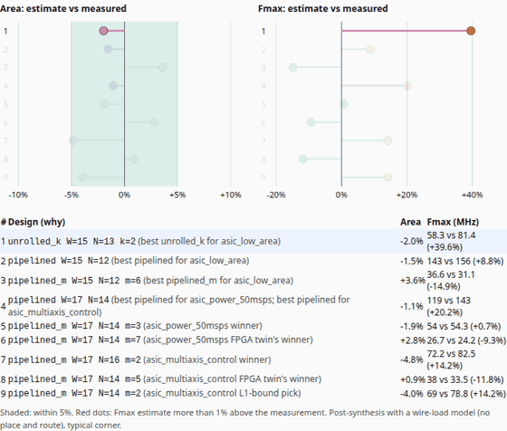          |
| 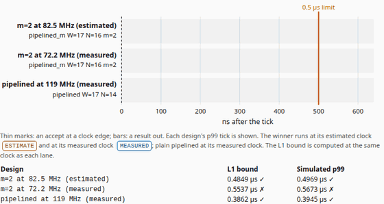 | 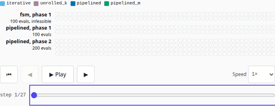             |
| 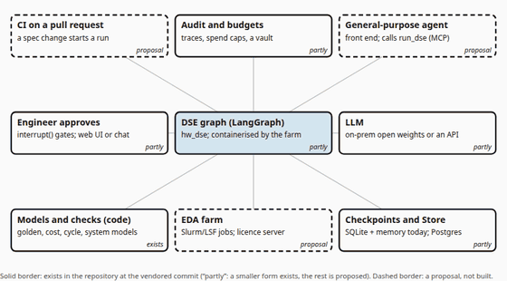            |                                                                                        |

## What the site claims, and why it is true

- **Ladder badges** come from the roadmap table in the agent repo's README at the vendored commit: M1 to M4 are all
  done, so every level is live: SimPy system-level and cycle-level simulation (the README's L2) since M3, the ASIC
  target (sky130, post-synthesis only, no place and route; an open-PDK estimate, not silicon) and the fleet since M4.
  The after-M4 items are shown as the project's plan with no results; a planned level is never animated as if it ran,
  and the home animation marks the levels its M2 run did not use.
- **M4 is animated from the repository's data and models at the vendored commit**: `scripts/export_m4.py` re-runs the
  sky130 calibration (`hw_dse.models.cost_asic.calibrate` must reproduce the committed in-sample and leave-one-out
  tables), re-evaluates the 9 held-out designs, sweeps every pipelining depth of each target's winner (the best
  feasible m must be the ground truth's), simulates the `asic_multiaxis_control` winner at its estimated and measured
  clocks (`hw_dse.l2.system`; the p99s must equal the ground truth and the held-out table), rebuilds one fleet run from
  its members' archived evaluations (`hw_dse.fleet`: lessons, phase-2 split, Store contents and selection must equal the
  run's summary) and recomputes the paired sign and t tests independently. Every M4 row of results.md is asserted
  verbatim, and the write-up's and README's sentences the site repeats are asserted too.
- **M4's honest result**: the fleet mapped the front worse (pooled sign test p = 0.014; significant for DeepSeek), and
  the review's fix did not change that; with Qwen the fixed fleet picked better designs (22 of 25 pairs, p = 0.0002),
  with the caveat that it ran hours after the single arm. The ASIC model's winner for `asic_multiaxis_control` misses
  its deadline at its measured 72.2 MHz, and its Fmax is optimistic on 5 of 9 held-out designs; the site states both
  first. The record's "45/45 selections meet spec" was checked against the summaries.
- **The local Vivado runs after M4 (PR #7)** come from `scripts/export_vivado_m4.py`: every row of the appended
  results.md section is asserted verbatim; the 20 ns MSPS are recomputed from each report's WNS and every model column by
  evaluating the designs under the M1 calibration and both refits; the 20 ns post-synthesis rows are checked to duplicate
  the 10 ns ones (why the `vivado-2025.2-m4` refit, counted once, is the `vivado-2025.2` fit); the class factor's outcome
  is recomputed from its rule's two conditions; post-route / post-synthesis ratios from the three CSVs; the power index
  against Vivado's vectorless core power with the site's own ranks and RMS, and the per-family activity fit in-sample
  and leave-one-out. One disclosed difference: two designs tie at 22.0 mW post-synthesis, and the repository's Spearman
  (0.982) ranks the tie by order; averaging the tied ranks gives 0.988. The site shows both.
- **"For a hardware team"** (`/adoption`) states what is true of the vendored commit and labels the rest a proposal:
  every claim about the agent links to its evidence (a repository file at the commit, or a page here); its numbers are
  values from the site's data or the write-up's named facts (`tests/unit/adoption.test.ts` resolves every one and
  checks every README anchor); general-purpose agents are described by capability, not by benchmark; no company is
  named.
- **L2 is animated from the repository's own models at the vendored commit**: the `multiaxis_control` replay is
  `hw_dse.l2.system` run by the export for the three winners, and its p99 batch latencies must equal the committed
  ground truth; the waveform is `hw_dse.l2.cycle` driven by the L2 validation's stimulus, closed loop, and must take
  exactly as many edges, accepts and results as each of the 24 RTL logs recorded in `l2_cycle_validation.csv`.
- **M3's honest result**: the campaign agent (Deep Agents) gained nothing over the structured graph at 1.44–2.25× the
  cost per run, Qwen looped in 4 of 30 campaigns, and in 52 of 65 campaigns its plan was one call to the structured
  graph; memory showed no benefit. It is shown as experimental. System simulation changes the winner on
  `multiaxis_control`; on `bursty_offload` a peak-rate floor (recomputed by the export over the exhaustive grid) gives
  the same winner, and `dds_sfdr` is a negative result.
- **The honest headline**: M1's agent was the better _selector_ and NSGA-II the better _front-mapper_; M2 closed the
  front-mapping gap (0.96–1.09× NSGA-II's hypervolume) and kept the better selection in 8 of 9 model-and-spec cells.
  Where it got worse (Qwen on `high_precision`, DeepSeek's regret, the full budget every time) is stated first.
  Every model, on every seed of both milestones, declared the infeasible spec infeasible.
- **Costs** are provider-reported (OpenRouter) usage and dollars per run, per spec and per evaluated design, with
  model IDs and run dates; the export checks them against the traces (M1 $1.7367; M2 $1.6488 + pilot $0.0166 =
  traces $1.6654) and the key's usage before and after M2 ($1.657747); M3's ledger ($3.4901, 114 entries) against
  the summaries arm by arm, the archived traces ($3.4519 plus the $0.0382 of re-run entries) and the key ($3.5775);
  M4's ledger ($3.8438, 147 entries) against the summaries arm by arm, the traces against INDEX.md ($3.8366) and the
  key ($4.15: $3.83 first pass + $0.32 fixed-fleet re-run). Projections (the 24-hour throughput figures) are labelled.
- **Measurements** (L3 verification, formal, L4 synthesis, Vivado, the L5 refits) are the repo's tables; the export
  recomputes every M1 estimate and refit prediction with the Python reference and checks the summaries against the
  repo's own text.
- **The hypervolume race** re-runs NSGA-II and random search with the repo's own code at the vendored commit
  (Optuna pinned in `reference/requirements.txt`); the export refuses a curve unless the re-run reproduces the
  recorded final hypervolume, evaluations to 95% and selected design exactly.
- **The calculator** projects only from measured means; the reader enters any rate or hours, and nothing is
  pre-filled.
- **Provenance labels** follow the repo: _exact_ (bit-accurate golden model), _estimate_ (cost model calibrated to two
  Vivado results, the sky130 model fitted to 57 points, a named refit, or an L1 analytic bound), _measured_ (tool and
  version named), _simulated_ (the L2 SimPy model, clocked at the design's estimated Fmax, or at a measured one where
  the page says so).

## Data and models

```
vendor/hw_dse/            HW_Design_Space_Agent files at the pinned commit (VENDORED.json: commit + sha256 per file)
scripts/vendor-dse.ts     pnpm vendor:dse <commit>: copies them from `git show`, never the working tree
scripts/export_dse.py     vendored files + the Python reference -> src/data/*.json and tests/fixtures/*.json;
                          every exported results row (M1 and M2) must appear verbatim in the repo's results.md
scripts/export_ladder.py  M2's ladder data -> src/data/ladder.json (L3, formal, L4, Vivado, L5, worked example)
scripts/export_m3.py      M3 -> src/data/m3.json: system-spec ground truth (+ the peak-rate view), the system replay,
                          the cycle waveforms, the structured arm, the A/B, memory on/off, the levers, the M3 spend;
                          every M3 row of results.md asserted verbatim
scripts/export_m4.py      M4 -> src/data/m4.json: the sky130 calibration (re-fitted), the ASIC ground truth on both
                          targets with the depth sweeps, the held-out check, the deadline replays, the ASIC eval, the
                          fleet A/B and paired tests, one fleet run rebuilt, the L2 -> L1 feedback, the M4 spend and
                          the FPGA record's untouched prefix; every M4 row of results.md asserted verbatim
scripts/export_vivado_m4.py  the local Vivado runs after M4 -> src/data/vivado_m4.json: high_precision at 20 ns, the
                          refit counted once, the class factor's rule, post-route ratios, FPGA power vs the index
src/lib/dse/cordic.ts     TS port of the bit-exact CORDIC golden model
src/lib/dse/cost.ts       TS port of the Artix-7 cost model and the derived metrics
src/lib/dse/families.ts   the design point and its schedule
src/lib/dse/{hero,climb,datapath,captions}.ts   animation states and captions, pure functions
src/lib/dse/{trace,replay,race,calc,fleet}.ts    the replays, the race, the calculator and the fleet (part B)
src/lib/dse/{ladder,m2frames}.ts                 M2's ladder data and its animations' states (part C1)
src/lib/dse/m3.ts                                M3's data and its two animations' states and captions (part C2)
src/lib/dse/m4.ts                                M4's data and its four animations' states and captions (part C3)
src/lib/dse/vivado4.ts                           the local Vivado runs' data and quoted values (part C4)
src/lib/adoption.ts                              /adoption: the deployment as data, its animation's states (part C4)
src/lib/writeup.ts        the write-up's parser (/writeup): sections, named facts, the Mermaid flowchart
src/lib/record.ts         the project record's parser (/record)
src/data/runs/*.json      one file per recorded run (M1: <spec>__<stamp>, M2: m2__<spec>__<stamp>), loaded on demand
src/data/race.json        HV-fraction curves per milestone, spec, method and seed
src/data/ladder.json      M2's ladder data
src/data/m3.json          M3's data
src/data/m4.json          M4's data
src/data/vivado_m4.json   the local Vivado runs after M4 (PR #7)
```

The parity tests compare the TS ports with fixtures written by the Python reference **with no tolerance**: the atan
table, every register of every micro-rotation, the outputs on a sweep plus the edge codes, a SHA-256 over all 2^W
outputs for every W ≤ 16, and every field of the cost model for 100 designs across the four families. Only the
accuracy metrics (which take cos and sin) use a tolerance, far below one LSB.

## Checks

| Check                                                                                                                                                                                      | Command                                |
| ------------------------------------------------------------------------------------------------------------------------------------------------------------------------------------------ | -------------------------------------- |
| Unit tests (parity, frames, captions, values, vendored hashes), coverage thresholds                                                                                                        | `pnpm test:coverage`                   |
| Site data and fixtures up to date with the reference at the vendored commit                                                                                                                | `python scripts/export_dse.py --check` |
| Vendored data, trace cost sums, honesty checks, ladder data, M3 and M4 data                                                                                                                | `python -m pytest -q tests/python`     |
| e2e: every page at 1280 and 390 px in light and dark; every animation plays, steps, scrubs, resets and answers the keyboard; reduced motion; frame tests; ladder badges; wording; no email | `pnpm test:e2e`                        |
| axe (serious/critical) in light and dark                                                                                                                                                   | part of `pnpm test:e2e`                |
| Lighthouse ≥ 0.9 (performance, accessibility, best practices)                                                                                                                              | `pnpm lighthouse`                      |

```bash
pnpm install
python3 -m venv .venv && .venv/bin/pip install -r reference/requirements.txt
.venv/bin/python scripts/export_dse.py --check
pnpm dev
```

## Origin

The stack, styling and animation framework (Next 14, MDX, Tailwind, the stepper and clock, reduced-motion handling,
the CI and test layout) are copied from
[Agent Harnesses Explained](https://github.com/BrendanJamesLynskey/agent-harnesses-explained). This is a showcase,
not one of the `*-explained` family, so it does not carry the family's site switch; its footer links the related
agent sites and the [LLMs hub](https://github.com/BrendanJamesLynskey/LLMs) instead.

## Licence

MIT.
